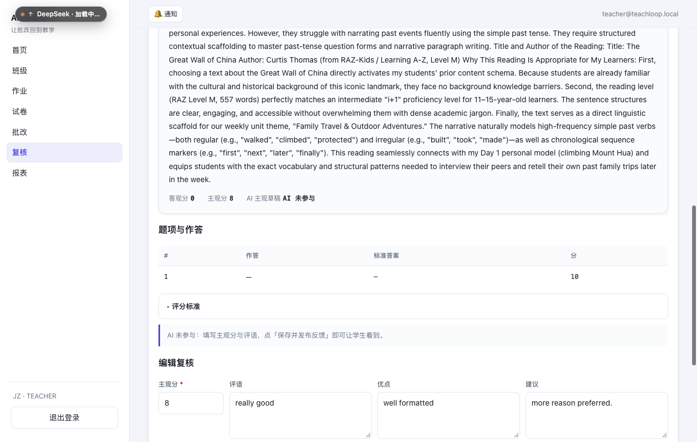

# D-15 人工判分（AI 可选）端到端验收（2026-10-20）

本目录是「老师不依赖 AI 直接判分并发布」的浏览器实测证据。
环境：本机 dev 栈，Postgres 16（`teachloop-pg`，55432）+ 后端 8010 + 前端 5173；判分引擎为 stub（本次没有调 AI）。

## 实测链路（全程不派发 AI）

1. 教师新建独立作业「D-15 人工判分验收作业」（20 分，演示班，截止 2026-12-15）。
2. 学生 01 提交正文；提交状态 `QUEUED`，**没有点「立即派发」**。
3. 教师在批改详情看到该行状态「待派发」，操作列有 **「判分 / 复核」**；点击直达
   `/review?submissionId=…`。
4. 判分页显示：客观分 0、当前主观分 0、**AI 主观草稿「AI 未参与」**，并提示「直接填写主观分与评语」。
   截图：`01-manual-review.png`。
5. 教师填主观分 **17.5**，评语、优点、建议；保存后状态 `EDITED`、submission 置 `DONE`；
   随后通过并发布。**复核页后来由并行的中文/UI 改造演化成「保存并发布反馈 / 仅保存草稿 / 退回重批」**，
   能力不变；当前界面截图：`04-current-review-ui.png`（`01`/`02` 是第一版界面的留档）。
6. 学生「我的反馈」显示 **17.5 / 20**、客观 0、主观 17.5、评语 + 优点 + 建议。
   截图：`03-student-feedback.png`。

## 当前界面



## 数据层断言

```sql
select s.grading_state, s.subjective_total, r.status, r.original_subjective,
       r.teacher_id is not null as teacher, r.published_at is not null as published
  from submissions s left join reviews r on r.submission_id = s.id
 where s.id = '<submission>';
-- DONE | 17.50 | APPROVED | (null) | t | t
```

`original_subjective = null` 表示 AI 未参与；主观分来自老师。
Worker 保护：如果人工判分后再把 submission 置回 PENDING，`GradingWorker` 会跳过并在日志打
`grading skipped ...: teacher already graded or review published`（由 `ManualGradingTest` 锁住）。

## 验证命令与结果

- `make test` → 退出码 0；surefire 汇总 **tests=203, failures=0, errors=0, skipped=0**（54 个报告类）。
- `check-i18n` → 前端 zh/en 各 907 键完全对齐；后端/前端新增中文字面量 0。
- `check-boundaries` / `check-deps` → 通过。
- `cd web && npx tsc --noEmit && pnpm run build` → 退出码 0。

## 备注

- 浏览器实测发现并修复了一处 i18n 命名空间不一致：ReviewPage 使用 `t('teacher.review.*')`，
  而文案实际在顶层 `review.*`，页面会显示裸 key；已改为 `review.*` 并逐键核对 zh/en 各 35 个全部存在。
- 批改详情现在对「已交卷且未拒收」的行都显示「判分 / 复核」，不再要求先派发 AI。
- 已知限制：仅打开判分页会懒建一条 PENDING 复核进入队列；驳回后 AI 不会自动重批（既有语义）；
  复核队列仍未按 URL 上的 `offeringId` 过滤。
